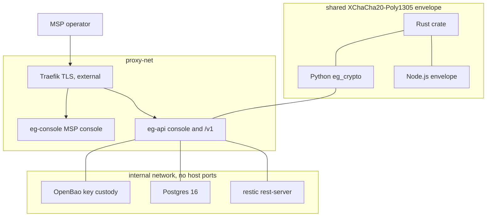
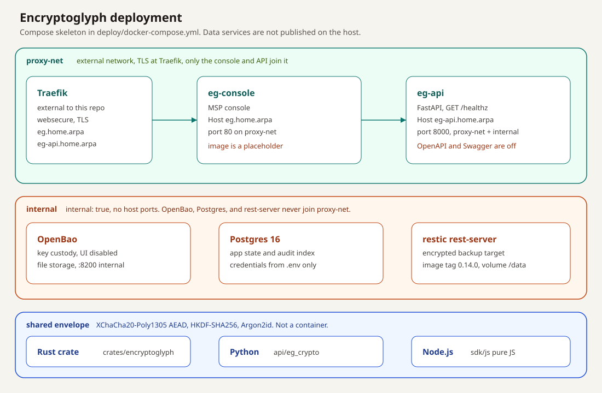

# Encryptoglyph

[](https://opensource.org/licenses/Apache-2.0)
[](https://github.com/GoDeskio/Encryptoglyph/actions/workflows/ci.yml)


Encryptoglyph is an open-source encryption-at-rest library and self-hosted service skeleton for managed service providers. It keeps field encryption, key custody, and encrypted backup in one place: an [XChaCha20-Poly1305](https://datatracker.ietf.org/doc/html/draft-irtf-cfrg-xchacha) AEAD envelope, an OpenBao custody service, a restic backup target, and an MSP console in front of them.

[Komboe](https://komboe.com) is the vault product that adopts this envelope. This repository is the shared crypto library and the deploy skeleton. It is licensed under the Apache License 2.0.

## Features

- **XChaCha20-Poly1305 AEAD.** New ciphertext uses a 192-bit nonce and a 256-bit key. The header carries a version, an algorithm id, and a key id. Legacy AES-256-GCM envelopes still decrypt, and `rewrap` upgrades them. Rust (`crates/encryptoglyph`), Python (`api/eg_crypto`), and Go (`bindings/go`) share the wire format and the vectors in `testvectors/envelope.json`.
- **Key custody.** The compose file runs OpenBao on an internal network for Transit keys and KV. The library itself has no escrow key and no master override. Root keys are 32 bytes, derived with HKDF-SHA256 per tenant, purpose, and algorithm, or from a password with Argon2id. The console and `/v1` sidecar do not call OpenBao. The custody design is in [docs/plan.md](docs/plan.md) and [docs/SECURITY-HARDENING.md](docs/SECURITY-HARDENING.md).
- **Encrypted backup.** `restic/rest-server` sits on the same internal network as the backup target. Host ports are not published. Backup scheduling and restore evidence are described in the plan and are not implemented in this tree.
- **Console.** `console/` is the operator UI, served by the API at `/`. It seals fields, rotates and shreds keys, shows fingerprints with current/retired status and timestamps, and runs a deterministic assistant. Inventory creates, lists, and shows tenant → site → device metadata in the current session only; it is lost on expiry or restart and does not provision custody or enroll devices. OpenBao and restic stay unwired. Backup health, restore tests, and escrow approvals explicitly report not implemented. See [INTEGRATION.md](INTEGRATION.md) for the `/v1` contract and limits. The compose service builds the same image as the API.

## What this tree runs

| Piece | In this repository |
| --- | --- |
| Rust envelope, HKDF, Argon2id, key rotation | Implemented and tested |
| Python module, wire-compatible with Rust | Implemented and tested |
| Node.js package `@godesk/encryptoglyph` | `sdk/js` and `bindings/ts`. Pure JS, Node >= 24, no `wasm-pack` step |
| `eg-api` container | `/healthz`, the `/v1` sidecar, and the console. Swagger, ReDoc, and `/openapi.json` are not served |
| OpenBao, Postgres 16, restic rest-server | Images and config in `deploy/docker-compose.yml`. The console reports them as not connected |
| Console | `console/`, served by the API. See [INTEGRATION.md](INTEGRATION.md) |

## Architecture

Traefik is external. Only `eg-console` and `eg-api` join `proxy-net`. OpenBao, Postgres, and the restic rest-server stay on the `internal` network (`internal: true`), which has no route off the Docker host. The API container is the only app process that joins both networks. The crypto libraries are not containers. The API image copies the console, `eg_crypto`, and the `/v1` service.



The lines from `eg-api` to OpenBao, Postgres, and rest-server are placement in the compose file, not live calls from the health handler.



The SVG is the same layout: [docs/img/architecture.svg](docs/img/architecture.svg).

## Quickstart

Docker Compose is the deploy entrypoint. Secrets stay in `deploy/.env`, which is gitignored. `deploy/.env.example` lists the names and leaves the values empty.

```bash
cp deploy/.env.example deploy/.env
docker network create proxy-net
docker compose -f deploy/docker-compose.yml config
```

`proxy-net` must already exist because the compose file marks it external. `docker compose config` is the check CI runs. Do not commit `.env`.

`docker compose up` builds `eg-api` and `eg-console` from `api/Dockerfile`. OpenBao, Postgres, and rest-server still expect real values in `.env` before they will start. The console does not require them.

The API image is buildable on its own. It listens on port 8000 inside the container and, in the compose file, publishes no host port. This loopback publish is only for a local health check:

```bash
docker build -t encryptoglyph-api:local -f api/Dockerfile api
docker run --rm -p 127.0.0.1:8000:8000 \
  -e BUILD_SHA="$(git rev-parse --short=12 HEAD)" \
  encryptoglyph-api:local
```

```bash
curl -sS http://127.0.0.1:8000/healthz
```

A healthy process returns `{"status":"ok","build":"<12 hex chars>"}`. `/docs`, `/redoc`, `/openapi.json`, and `/swagger` are not served. That is checked by `scripts/assert-exposure.sh`.

Without Docker, from `api/` with Python 3.12. This serves `/healthz`, `/v1`, and the console at `/`:

```bash
python -m pip install -r requirements.txt
BUILD_SHA="$(git rev-parse --short=12 HEAD)" python -m uvicorn main:app --host 127.0.0.1 --port 8000
```

Open `http://127.0.0.1:8000`. Adoption snippets are in [INTEGRATION.md](INTEGRATION.md). The assistant uses deterministic commands with no model. Set `OLLAMA_BASE_URL` when a local Ollama should choose those commands. It never receives plaintext or keys.

## API and SDKs

The HTTP API in this repository is the health check above. Envelope encryption is the library surface, with the same record context in each language: tenant, purpose, table, record id, field, and schema version. Those fields are authenticated as additional data, so a ciphertext cannot be moved to another row, field, or tenant.

### Rust

`crates/encryptoglyph` is the source of truth. `unsafe` is forbidden. Default writes are version 3, XChaCha20-Poly1305 with a key commitment.

```rust
use encryptoglyph::{decrypt, encrypt, Keyring, RecordContext, VERSION_V2};

fn seal_email() -> Result<Vec<u8>, encryptoglyph::Error> {
    let key = Keyring::generate_key()?;
    let kr = Keyring::new("k1", &key)?;
    let ctx = RecordContext {
        tenant: "acme".into(),
        purpose: "field".into(),
        table: "customers".into(),
        record_id: "42".into(),
        field: "email".into(),
        schema_version: 1,
    };
    let blob = encrypt(&kr, &ctx, b"ada@example.com")?;
    let plain = decrypt(&kr, &ctx, &blob, VERSION_V2)?;
    Ok(plain.to_vec())
}
```

```bash
cd crates/encryptoglyph
cargo test --locked
```

### Go

`bindings/go` matches the Rust wire format using `golang.org/x/crypto` (XChaCha20-Poly1305, HKDF-SHA256, Argon2id). `Encrypt` writes version 3. `Decrypt` still opens version 2 and legacy AES-256-GCM version 1. `Rewrap` writes a fresh version-3 blob.

```bash
cd bindings/go
go test -count=1
```

```go
import "github.com/GoDeskio/Encryptoglyph/bindings/go"

kr, err := encryptoglyph.NewKeyring("k1", key)
ctx := encryptoglyph.RecordContext{
    Tenant: "acme", Purpose: "field", Table: "customers",
    RecordID: "42", Field: "email", SchemaVersion: 1,
}
blob, err := encryptoglyph.Encrypt(kr, ctx, []byte("ada@example.com"))
plain, err := encryptoglyph.Decrypt(kr, ctx, blob, encryptoglyph.VersionLegacy)
```

Module path: `github.com/GoDeskio/Encryptoglyph/bindings/go`.

### Python

`api/eg_crypto` matches the Rust wire format. Tests run it directly. `pip install` of the `api` directory installs that package on its own (project name `eg-crypto`). FastAPI and uvicorn stay optional extras and in `requirements.txt`, which is what the API image installs. The image copies `eg_crypto` into the container.

From the `api` directory:

```python
from eg_crypto import Keyring, RecordContext, encrypt, decrypt

key = Keyring.generate_key()
kr = Keyring({"k1": key}, "k1")
ctx = RecordContext(
    tenant="acme",
    purpose="field",
    table="customers",
    record_id="42",
    field="email",
)
blob = encrypt(kr, ctx, b"ada@example.com")
assert decrypt(kr, ctx, blob) == b"ada@example.com"
```

```bash
cd api
python -m pip install .
python -m pip install -r requirements-dev.txt
pytest
```

### Node.js

`@godesk/encryptoglyph` is plain ECMAScript in `sdk/js` (and the same envelope file in `bindings/ts`). It runs on Node.js 24 or newer and does not run `wasm-pack`. XChaCha20-Poly1305 uses HChaCha20 plus Node's ChaCha20-Poly1305. HKDF-SHA256 and Argon2id use `node:crypto`. The package decrypts `testvectors/envelope.json`.

From a checkout:

```bash
npm install ./sdk/js
node --test sdk/js/test/vectors.test.js
```

The Rust `wasm` feature still builds for `wasm32-unknown-unknown`. `fpe` and `blahaj` stay in the crate's main dependency table, and the wasm32 graph enables `getrandom` `js` plus `getrandom` 0.4 `wasm_js`. `bindings/ts` can still pack that feature when a browser build is needed:

```bash
cd bindings/ts
npm run build:wasm
npm run build:wasm:node
node vector-test.cjs pkg-node
```

Git installs use the repository root `package.json`, which points at the same files:

```bash
npm install github:GoDeskio/Encryptoglyph#<ref>
```

A packed tarball is `sdk/js/godesk-encryptoglyph-0.2.0.tgz`.

```js
import { Keyring, encrypt, decrypt } from "@godesk/encryptoglyph";

const key = crypto.getRandomValues(new Uint8Array(32));
const kr = new Keyring("k1", key);
const ctx = { tenant: "acme", purpose: "field", table: "customers", recordId: "42", field: "email" };
const blob = encrypt(kr, ctx, "ada@example.com");
const plain = decrypt(kr, ctx, blob);
```

The browser sidecar client remains `sdk/js/encryptoglyph.js`. It calls `/v1` and does not seal locally. The envelope module is for Node, where `node:crypto` provides the primitives.

## Security model

- **Authenticated encryption.** Version 2 is XChaCha20-Poly1305-IETF. The header (magic, version, algorithm, key id, nonce) is part of the additional data, together with the canonical record context. Flipping the version or moving the blob between records fails authentication.
- **Key separation.** A root key never encrypts plaintext directly. HKDF-SHA256 derives a data key from the root key, the purpose, the tenant, and the algorithm. Password root keys use Argon2id with a 16-byte salt.
- **Rotation.** A `Keyring` encrypts with the current key id and can decrypt older ids. `rewrap` writes a fresh version-3 blob. The current key cannot be retired.
- **Uniform failures.** Decrypt errors do not distinguish a bad tag from a malformed header.
- **No backdoor in the library.** There is no escrow or override key in the Rust or Python code. Custody of root keys is an OpenBao operation. This console keeps session keys in process memory and says so.
- **Network.** Compose does not publish host ports. OpenBao's own UI is disabled. Postgres passwords come from the gitignored env file.
- **Dependency licenses.** `cargo deny` allows Apache-2.0, MIT, BSD, ISC, MPL-2.0, Unicode, Zlib, and CC0. The check runs in CI.

Report vulnerabilities to security@komboe.com. The process is in [SECURITY.md](SECURITY.md). Hardening notes and the Komboe adoption plan are in [docs/SECURITY-HARDENING.md](docs/SECURITY-HARDENING.md) and [docs/design/komboe-integration.md](docs/design/komboe-integration.md).

## License

Encryptoglyph is open source under the [Apache License, Version 2.0](https://www.apache.org/licenses/LICENSE-2.0). See [LICENSE](LICENSE) and [NOTICE](NOTICE). Copyright 2026 GoDesk.

Third-party components stay under their own licenses. See [THIRD_PARTY_NOTICES.md](THIRD_PARTY_NOTICES.md).

Contributions are licensed under Apache-2.0. Read [CONTRIBUTING.md](CONTRIBUTING.md) and the [Contributor Covenant](CODE_OF_CONDUCT.md) before opening a pull request.

## Project links

- [Public marketing site source and hosting notes](site/) — intended hostname: `encryptoglyph.godesk.io` (deployment pending).
- [Komboe](https://komboe.com)
- [Security policy](SECURITY.md)
- [Contributing](CONTRIBUTING.md)
- [Code of conduct](CODE_OF_CONDUCT.md)
- [Product plan](docs/plan.md)
- [Adoption across GoDesk](ADOPTION.md)
